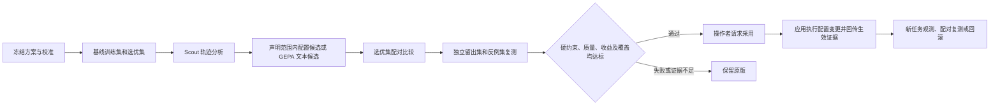

# 评测与 RSI

## 评测回答什么

评测在冻结任务、应用版本、配置、评分规则和预算的条件下，判断应用是否完成业务要求。Inspect 执行任务并保存原生 `.eval` 日志；Evals 适配器调用外部应用，按证据产生业务判定。平台不会替目标应用重写 Agent 或 RAG。

八维为：结果、检索、证据、过程、稳定性、异常处理、成本效率、安全权限。每题只声明适用维度。每个判定为通过、失败、无法核验、评分错误、未执行或不适用。缺少证据不算通过，适用检查覆盖率和有效通过率分别展示。

确定性规则核对实际结果、工具返回和状态；可选语义评分器必须先用独立标注校准。安全和其他硬约束不由模型评分替代。适配器负责提供真实、可追溯的证据；平台不能仅凭适配器的声明证明整个业务系统安全。

## 从评测到配置改进

四个数据分区各有用途：`train` 用于分析和生成候选；`selection` 用于筛选候选；`holdout` 用于最终独立验证；`counterexample` 检查已知风险。候选只能修改应用声明的资产和值域；生成文本还须满足显式授权及长度限制。

候选先满足硬约束，再检查质量退化容忍度和主目标收益。比较按业务组进行配对 bootstrap，处理同题重复运行的相关性，输出置信区间；缺少独立业务组、完整配对或费用时保留证据不足。极小样本通过不能推导长期收益。

## RSI 的两层含义

第一层是应用配置改进：分析失败、提出候选、独立复测、申请采用、核对实际生效版本、观测新任务。候选不是代码自动修改，也不是模型权重训练。平台只记录采用请求；目标应用实际执行变更，匹配版本和配置指纹的有效回执才更新生效状态。

第二层是平台搜索策略改进：在冻结的新任务上，对旧策略、简单规则和新策略安排配对实验，限制每臂相同预算。`strategy_studies` 汇总独立验证收益、后续误推风险、费用和人工介入；满足预先声明门槛后才在已验证的应用范围更新默认策略。证据不足时不提升策略。

采用后单臂观测只描述结果；设置 `compare_previous=true` 才会在同一代码版本上对新旧配置进行配对复测。失败案例经过脱敏确认才能回流为回归样本；已看过的案例不能再次作为未见留出题，后续调优必须更换独立留出数据。

## 控制、费用与失败

实验级暂停和取消由 Evals 管理，原生任务控制由 Inspect 管理，GEPA 在候选边界检查停止条件。应用、评分、分析、反思分别记账，每次派发前先预留预算；费用未知时停止后续调用，人工核对后恢复。预留是对账机制，实际模型费用可能超过单次估算，不能视为供应商硬性扣费上限。

原始失败与修复后的重跑分别保存。`completed` 表示实验执行结束，业务成功率和推荐结论须单独查看。只有 `recommend` 且独立验证通过的候选允许申请采用。

## 当前证据边界

2026-11-07 使用真实 `deepseek-flash`，在 VeraAgent 临时代码沙箱及 NexRAG 原生工具/证据循环中分别完成 4 轮基线评测，另各有 1 次预检。NexRAG 使用生成的公开资料，未连接生产向量库或业务数据库。首次 VeraAgent 运行存在失败样本，保留原记录后澄清命令约束重跑。

以上证明了登记场景中的实模调用与业务检查链路。多候选独立验证、采用与回滚、三臂策略门槛另有确定性隔离回归；长期在线效果、负载稳定性、真实模型驱动的持续 RSI 收益尚未验证。
